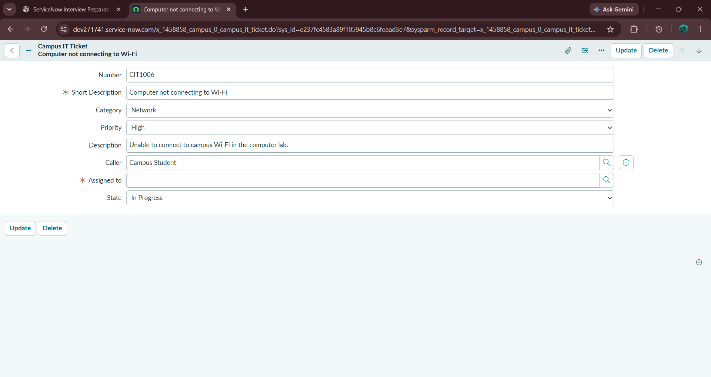
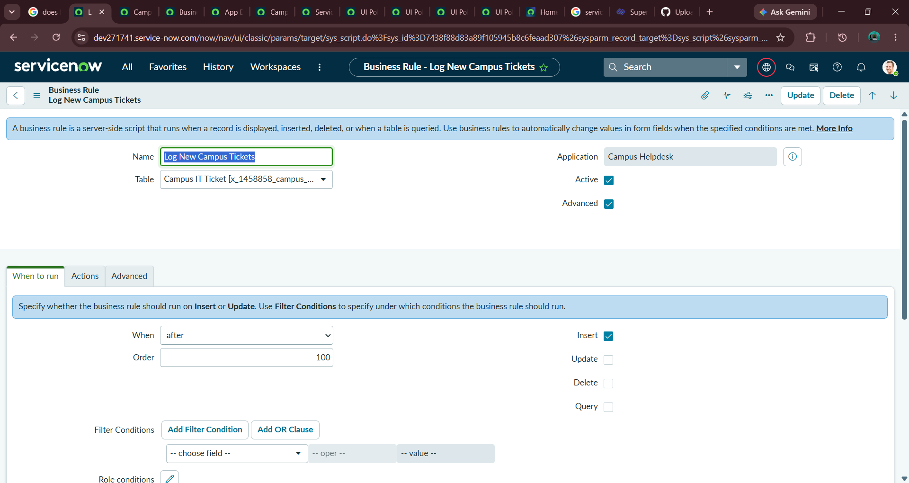
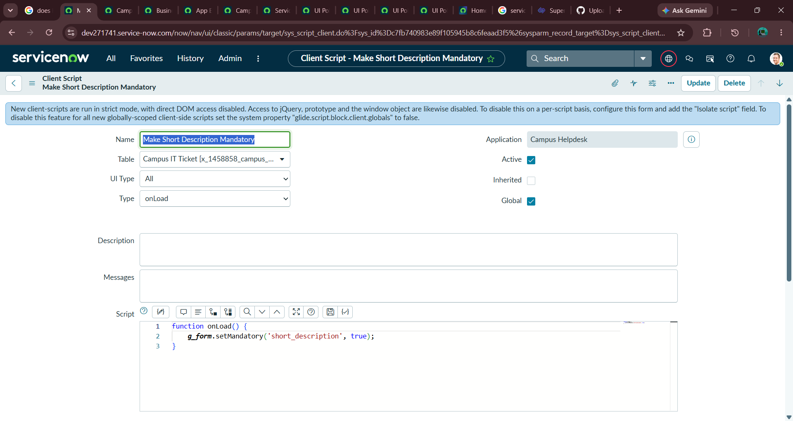
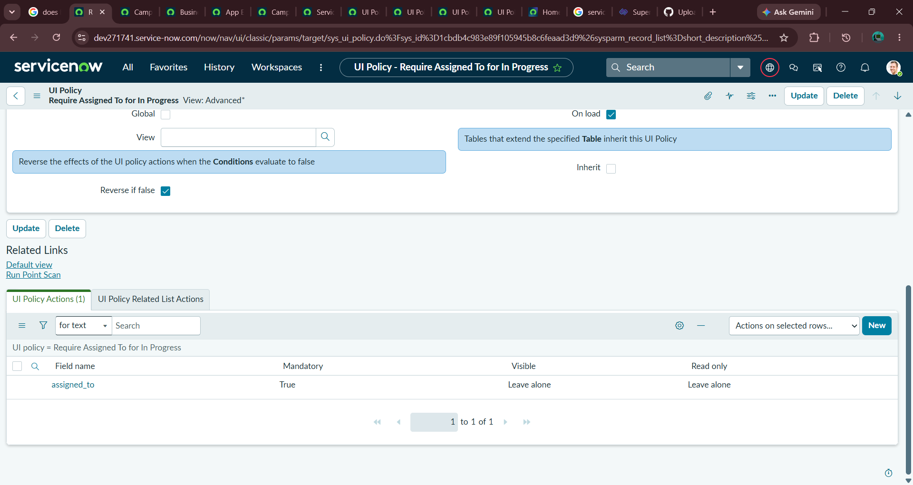
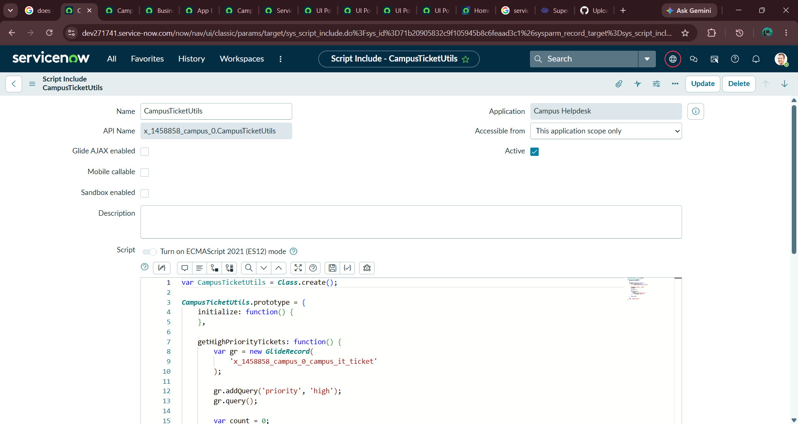
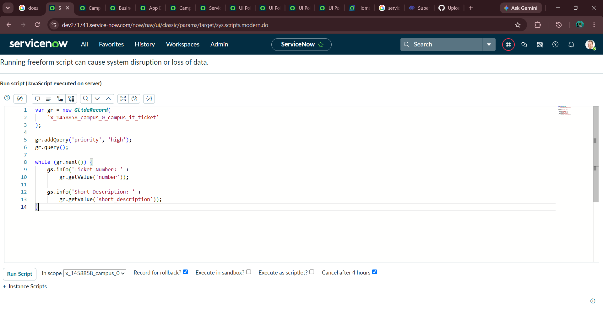
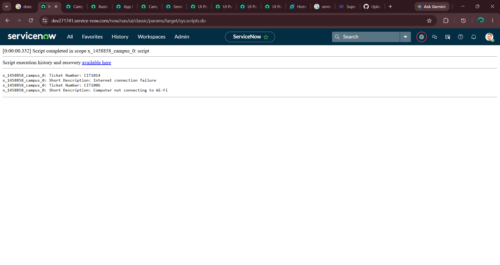
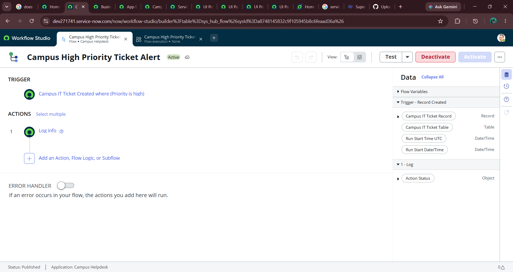
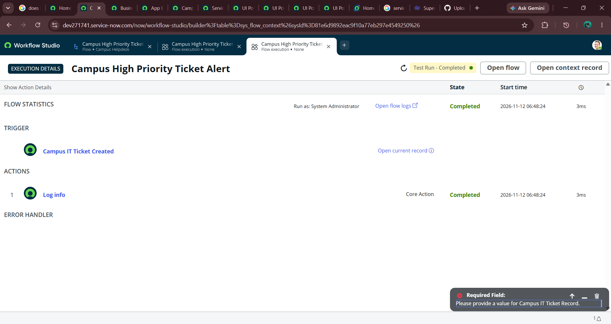

# Campus Helpdesk – ServiceNow Application

## Project Overview
Campus Helpdesk is a custom IT ticket management application developed using the ServiceNow platform. It helps manage campus IT issues by creating tickets, tracking their status, and applying automated rules.

## Objectives
- Create and manage campus IT support tickets.
- Track ticket priority and status.
- Ensure important ticket fields are completed.
- Automate actions for high-priority tickets.

## Technologies Used
- ServiceNow App Engine Studio
- JavaScript
- GlideRecord API
- Business Rules
- Client Scripts
- UI Policies
- Script Includes
- Flow Designer

## Features Implemented

### 1. Custom Ticket Management
Created a custom Campus IT Ticket table with:
- Auto-generated ticket numbers (CIT1001 onwards)
- Short Description
- Description
- Category
- Priority
- State
- Caller
- Assigned To

### 2. Business Rule
Created an After Insert Business Rule to log newly created ticket numbers.

### 3. Client Script
Implemented an onLoad Client Script to make Short Description mandatory.

### 4. UI Policy
Configured a UI Policy to make Assigned To mandatory when the ticket state is In Progress.

### 5. GlideRecord
Used GlideRecord to retrieve high-priority tickets from the custom table.

### 6. Script Include
Created a reusable server-side Script Include named `CampusTicketUtils` to count high-priority tickets.

### 7. Flow Designer
Created a flow that triggers when a new high-priority campus ticket is created and executes a Log Info action. The test execution completed successfully.

## Project Screenshots

### Ticket Form

### Business Rule

### Client Script

### UI Policy

### Script Include

### GlideRecord Execution

### Flow Designer

### Flow Execution

## Learning Outcomes
- Understanding ServiceNow application development.
- Working with server-side and client-side scripting.
- Configuring form behavior using UI Policies.
- Querying records using GlideRecord.
- Creating reusable server-side logic.
- Building low-code automation using Flow Designer.

## Author
**Bala Shanmukha Sowmya Javvadhi**
